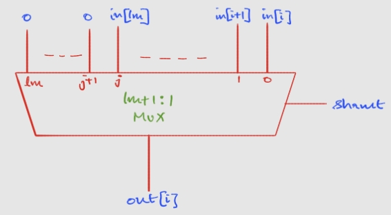
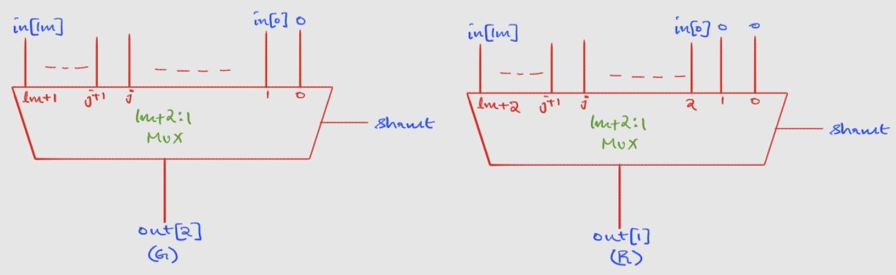
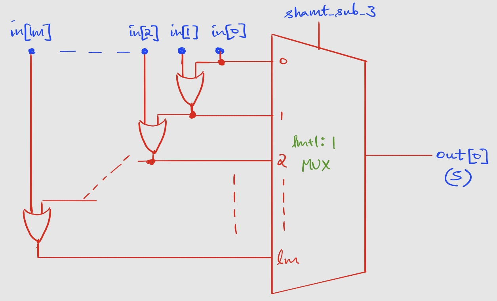

# Mantissa Alignment
**File** - [`lm_r_shifter`](../rtl/datapath/lm_r_shifter.v)
## Purpose
- To receive the *lm+1* input mantissa bits *in* (with leading 1 for normalized numbers and 0 for sub-normal numbers) of $B_0$ (number with smaller exponent), and right-shift the bits based on the input *shamt* from the exponent-comparator.
- To output the $lm+1$ right-shifted mantissa bits, along with rounding suffix bits: G, R and S. The output is collectively passed as a single $lm+4$ bit vector *out*.

## Architectural Decisions
### Shift-Amount Clipping
- The shift-amount *shamt* is obtained from the exponent-comparator, which is an *le*-bit vector. Hence, input *shamt* varies from $[0, 2^{le} - 1]$.
- There are a total of *lm+4* output bits (*lm+1* mantissa bits and G, R, S), and usually, even in the case of 32-bit single-precision fp, $lm+4 << 2^{le}$ or $le >> log_2(lm+4)$
- At a shift of *lm+3*, every input bit has already moved past the R bit and into the sticky region. For all values of *shamt ≥ lm+3*, the output is therefore identical, **including** the sticky bit: an all-zero mantissa with S equal to the OR of all input bits. Hence, to avoid unnecessary hardware, the *shamt* input is clipped to *lm+3* using a **min** circuit, described in [Utility Blocks](./utils.md#min---minimum-selector).
- The *le*-bit *shamt* is clipped to an *le*-bit vector *shamt_* first, and only then are its upper bits truncated, with only the $\lceil log_2(lm+4)\rceil$ least significant bits being passed to the select lines of the barrel shifter.

    (*Check out [Test 6](./logs/running_doc.md#test-6) wherein I discovered the error in my previous methodology of truncating first and then clipping*)
### Barrel Shifter
- A **barrel shifter** circuit was constructed using a **generate** block to perform the right-shift operation. For each output bit in [lm+3:3], an *(lm+4)*:1 multiplexer is instantiated. Output bit *i+3* receives `in[i+j]` for a shift of *j*, and zeros once the shift exceeds the available input bits:
```verilog
.in({{(i+3){1'b0}},in[lm:i]}), // shift in zeros
.sel(shamt_[$clog2(lm+4)-1:0]),
```
- Every mux in the shifter has *lm+4* inputs, so that the same truncated select works for all of them. Given below is the diagram of a single multiplexer in the barrel shifter:


**\*\*Note:** The drawing shows the earlier *lm+1*:1 mux. The current mux has three more zero inputs at the top (*i+3* zeros in total), as in the code above.

(*Check out [Test 13](./logs/running_doc.md#test-13), where differently-sized muxes with differently-truncated selects mis-shifted bf16 operands*)
### Rounding Suffix Bits
- The final result mantissa is outputted in this format: 

    [--shifted-manstissa--] | G R S

- G and R bits are the immediate two spill-over bits from right-shifting. They are obtained by simply **extending the barrel shifter**, by adding two more *(lm+4)*:1 muxes corresponding to the G and R bits. The input lines are padded with zeros so that G receives `in[j-1]` and R receives `in[j-2]` for a shift of *j*:
```verilog
.in({2'b00,in[lm:0],1'b0}), // G mux
.in({1'b0,in[lm:0],2'b00}), // R mux
```


**\*\*Note:** The drawing shows the earlier mux sizes. Both muxes now have *lm+4* inputs, with the extra zero inputs at the top.

(*Check out [Test 11](./logs/running_doc.md#test-11), where the G and R muxes skipped the leading bit `in[lm]`*)
- The S bit is obtained by performing a **reduction OR** on all the bits that are shifted out of the mantissa, beyond the G and R bits. This means that the reduction OR is applied on a variable number of input mantissa bits, given by *shamt-2*, i.e. bits `in[shamt-3:0]` (for *shamt* < 3, the S bit is 0).
- A **ripple OR-bank** was created to perform the reduction OR operation on every first *i+1* bits, `in[i:0]`, where *i* ranges from 0 to *lm*. The output of each intermediate reduction-OR was tapped as the input line to an *(lm+1)*:1 multiplexer, whose select line was *shamt-3*
- *shamt-3* is computed by a small CLA adding the constant $-3$. Its carry-out is 1 exactly when *shamt ≥ 3*, and gates the multiplexer output so that S is 0 for smaller shifts.
- Given below is the diagram for the S bit generation circuit:


## Architectural Diagram
Refer to the *Right Shift* block and its `out`, `g`, `r`, `s` outputs in the [microarchitectural diagram](../README.md#architecture).
